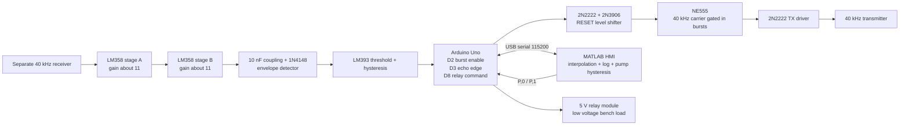
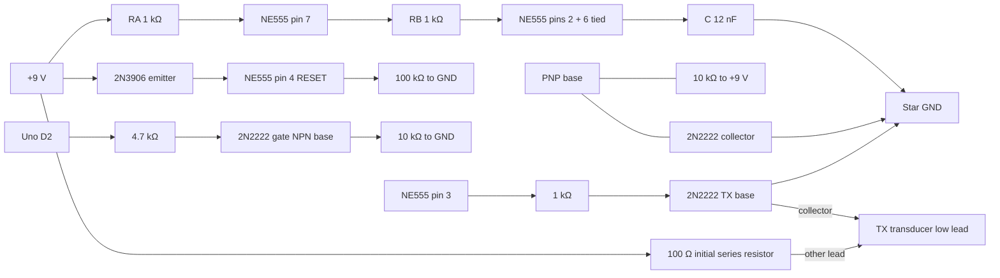
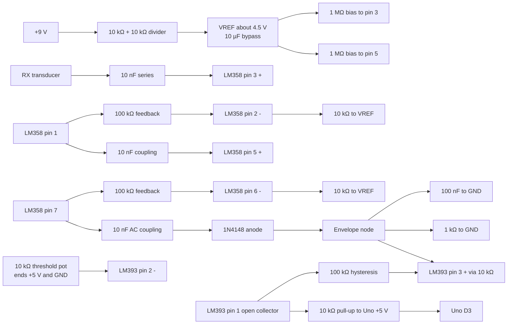

# Circuit Diagrams

These diagrams show the signal and power connections; use the DIP pin-by-pin schedule in `HARDWARE.md` for soldering. They are the Day 1 design to bench-validate, not a certified construction drawing. The supplied reference images are not the approved netlist.

## System interconnect

## Transmitter net diagram

Pin 4 is enabled only when Uno D2 is high: the gate NPN pulls the PNP base low, allowing the PNP to raise RESET to +9 V. A floating/low D2 leaves RESET pulled down and disables the 555.

## Receiver and comparator net diagram

Add 100 nF directly across the supply pins of each IC. LM358 pins 8/4 use +9 V/GND; LM393 pins 8/4 use Uno +5 V/GND. All signal grounds return to the star point. The envelope diode polarity, gain, and threshold must be checked on a scope with the actual transducers.
